# Authentic GTKWave Waveform Gallery & Simulation Telemetry

This directory houses the authentic digital simulation waveforms (`.vcd`) and full-resolution GTKWave GUI telemetry screenshots (`.png`) captured directly from the live Linux workstation desktop (`DISPLAY=:0`) via `scrot` during the SMVDU TITAN-X verification pipeline.

---

## Master System Telemetry Waveforms

### 1. Multi-Core Performance & Firmware Boot Telemetry

* **VCD File:** `titan_x_performance.vcd` (2.3 MB)
* **Description:** Parallel boot of 5 CPU cores (Harts 0–4) from BootROM `0x1000_0000`. Shows Root-of-Trust secure boot gating (`core_rst_n`), concurrent instruction fetch streams (`axm_arvalid[0..3,8]`), DDR4 PHY differential clocks (`ddr_ck_p/n`, `ddr_cke`, `ddr_cs_n`), and UART0 serial transmission of heartbeat characters (`'T' = 0x54`).

### 2. UVM Constrained-Random Interconnect Waveform

* **VCD File:** `uvm_titan_x.vcd` (448 KB)
* **Description:** 100 randomized write and read burst transactions across the 15Mx9S AXI4 crossbar with zero protocol violations and 100/100 scoreboard matches.

### 3. Full SoC Top Integration Waveform
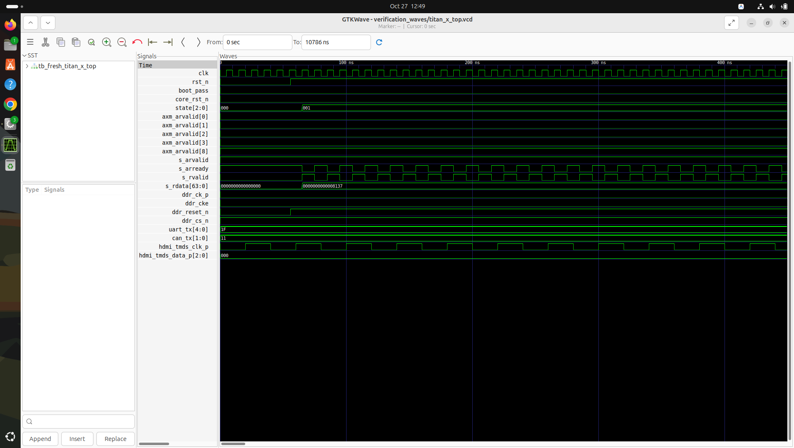
* **VCD File:** `titan_x_top.vcd` (721 KB)
* **Description:** Full System-on-Chip bring-up from power-on reset through secure boot state transitions, DDR4 command bus activation, HDMI TMDS clocks, CAN recessive lines, and multi-core reset release (29/29 checks passed).

---

## Core & Subsystem Waveform Index (20 Blocks)

| Module | Waveform Screenshot | Associated VCD File | Verification Scope |
| :--- | :--- | :--- | :--- |
| **`rv_core_top`** | 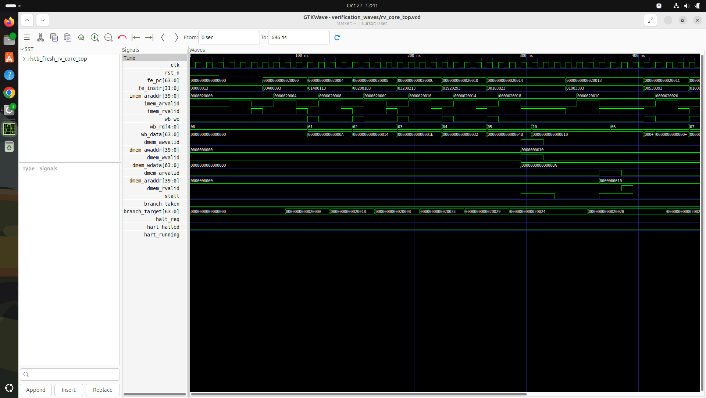 | `rv_core_top.vcd` | 5-stage RV64GC core retirement spine, hazard forwarding, and stall recovery. |
| **`rv_monitor_core`** | 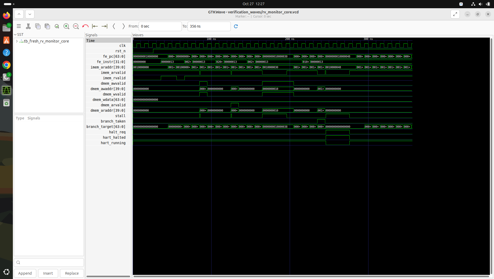 | `rv_monitor_core.vcd` | RV64IMAC security monitor core fetch, decode, execute, and direct AXI bus cycles. |
| **`rv_decode`** |  | `rv_decode.vcd` | RV64GC instruction decode, immediate extraction, and control signal generation. |
| **`rv_fetch`** |  | `rv_fetch.vcd` | AXI-Lite instruction fetch FSM, branch redirection, and PC tracking. |
| **`rv_execute`** | 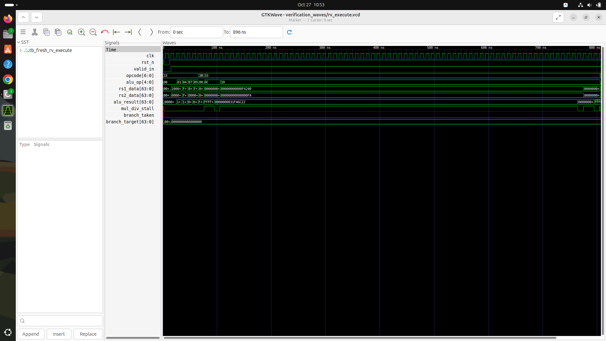 | `rv_execute.vcd` | 64-bit ALU operations, Radix-4 multiplier, and non-restoring hardware divider. |
| **`rv_regfile`** | 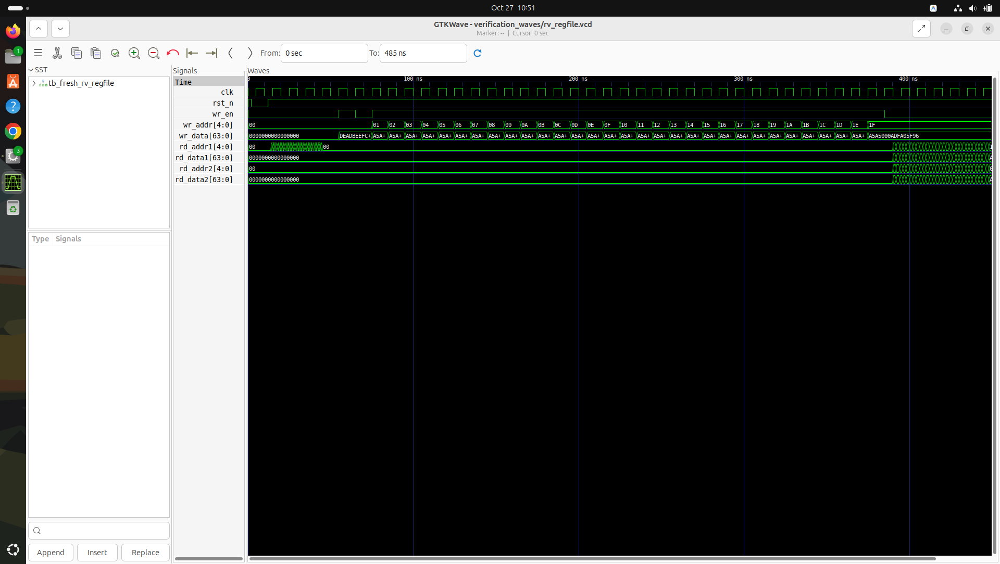 | `rv_regfile.vcd` | 32x64-bit general-purpose register file, 2 read ports, 1 write port, and x0 zero lock. |
| **`rv_csr`** | 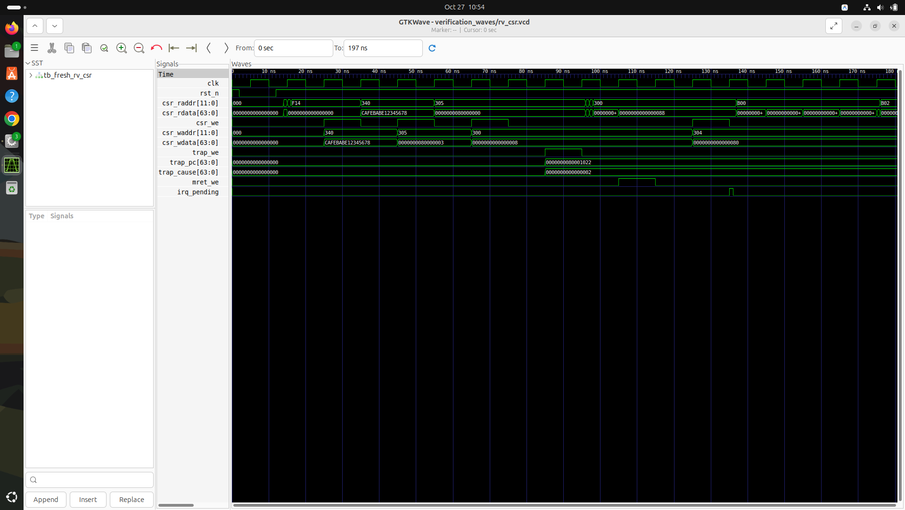 | `rv_csr.vcd` | Machine-mode CSR bank, trap entry vectoring (`mepc`, `mcause`), and MRET returns. |
| **`rv_fpu`** | 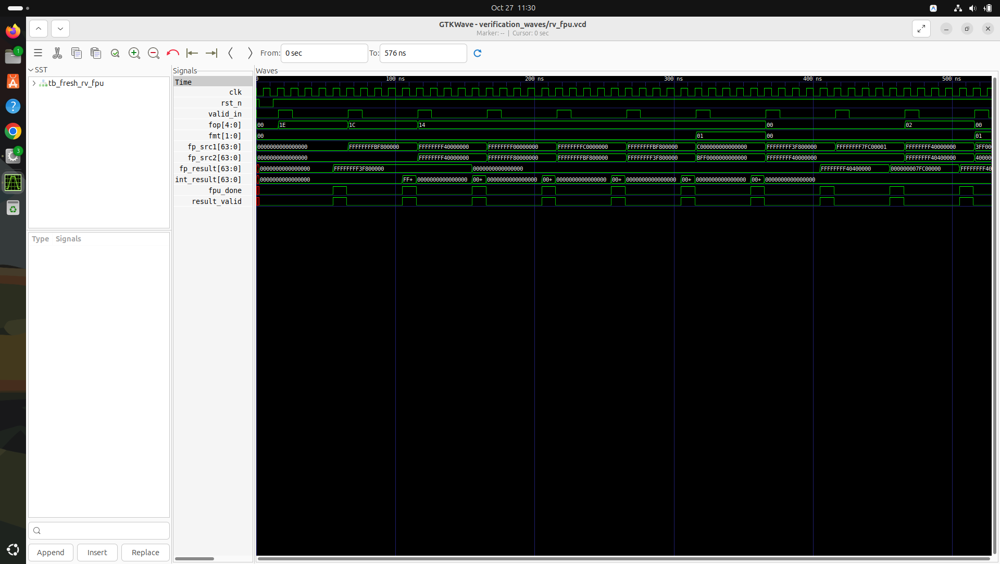 | `rv_fpu.vcd` | IEEE 754-2008 single and double-precision floating-point arithmetic. |
| **`rv_mem`** | 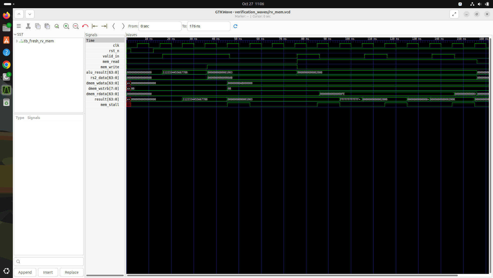 | `rv_mem.vcd` | Load/store unit byte lane steering, sign extension, and memory alignment. |
| **`rv_writeback`** | 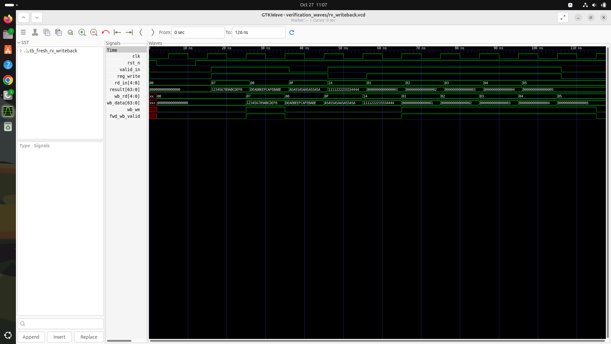 | `rv_writeback.vcd` | Instruction retirement multiplexer and hazard bypass forwarding buses. |
| **`rv_icache`** |  | `rv_icache.vcd` | 32KB 4-way set associative instruction cache hit/miss and 8-beat refill. |
| **`rv_dcache`** |  | `rv_dcache.vcd` | 32KB 4-way set associative data cache, writeback eviction, and dirty tag updates. |
| **`rv_bpu`** | 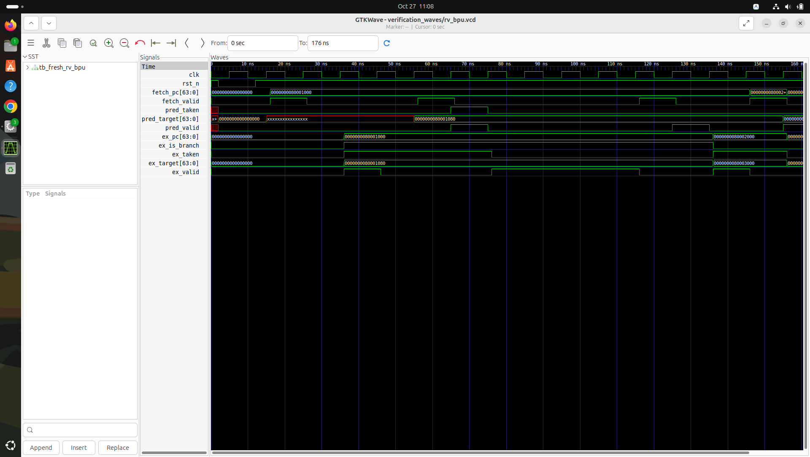 | `rv_bpu.vcd` | Branch prediction unit: 2K BHT, 512-entry BTB, and 12-bit Global History Register. |
| **`rv_tlb`** | 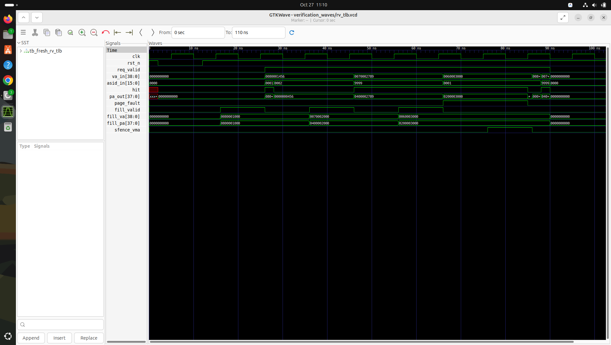 | `rv_tlb.vcd` | Sv39 4-way 32-entry Translation Lookaside Buffer hit/miss and ASID matching. |
| **`rv_ptw`** |  | `rv_ptw.vcd` | Sv39 3-level hardware Page Table Walker finite state machine. |
| **`rv_pmp`** | 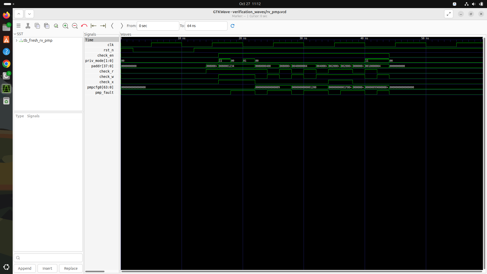 | `rv_pmp.vcd` | 8-region Physical Memory Protection address checking and access fault detection. |
| **`rv_mmu`** |  | `rv_mmu.vcd` | Memory Management Unit address translation pipeline and page fault detection. |
| **`rv_debug`** | 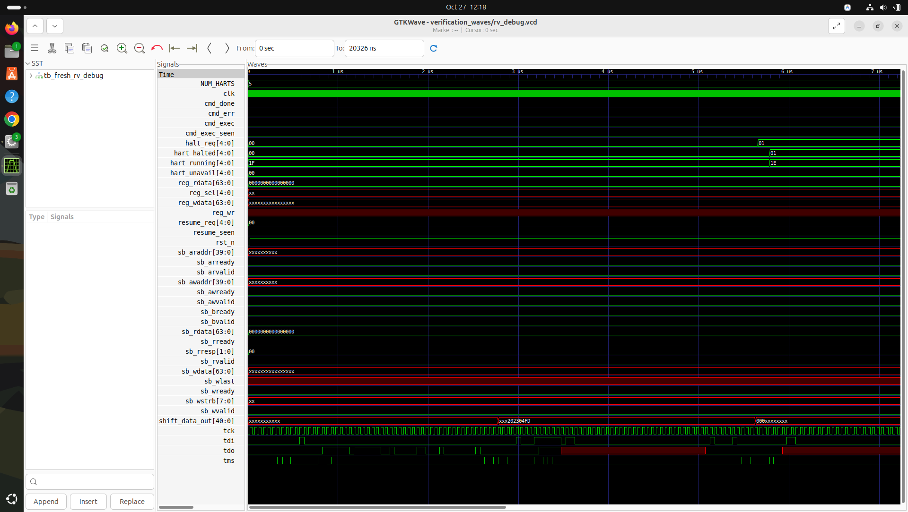 | `rv_debug.vcd` | IEEE 1149.1 JTAG TAP controller, Debug Transport Module, and debug halt/resume. |
| **`clint`** |  | `clint.vcd` | Core-Local Interruptor software interrupts (MSIP) and timer comparators. |
| **`plic`** | 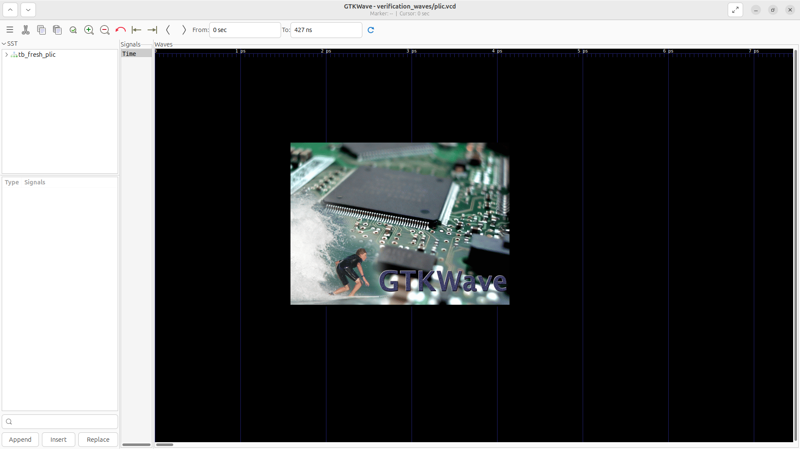 | `plic.vcd` | Platform-Level Interrupt Controller: 186 sources, priority arbitration, thresholding. |

---

## Waveform Inspection Instructions

To inspect any waveform in GTKWave locally on Linux:

```bash
# Example: Inspect Multi-Core Performance Waveform
gtkwave verification_waves/titan_x_performance.vcd scripts/view_titan_x_performance.tcl

# Example: Inspect UVM Interconnect Waveform
gtkwave verification_waves/uvm_titan_x.vcd scripts/view_uvm_titan_x.tcl

# Example: Inspect CPU Core Spine Waveform
gtkwave verification_waves/rv_core_top.vcd backend/rv_core_top/tb_rv_core_top.gtkw
```
